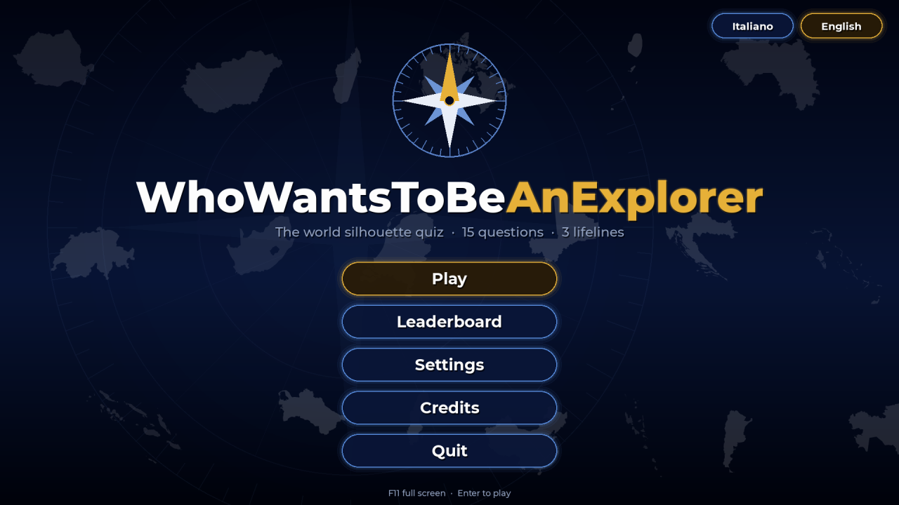
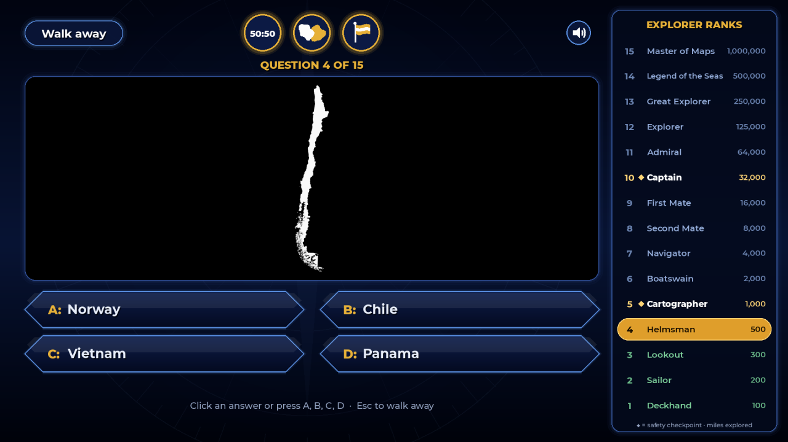
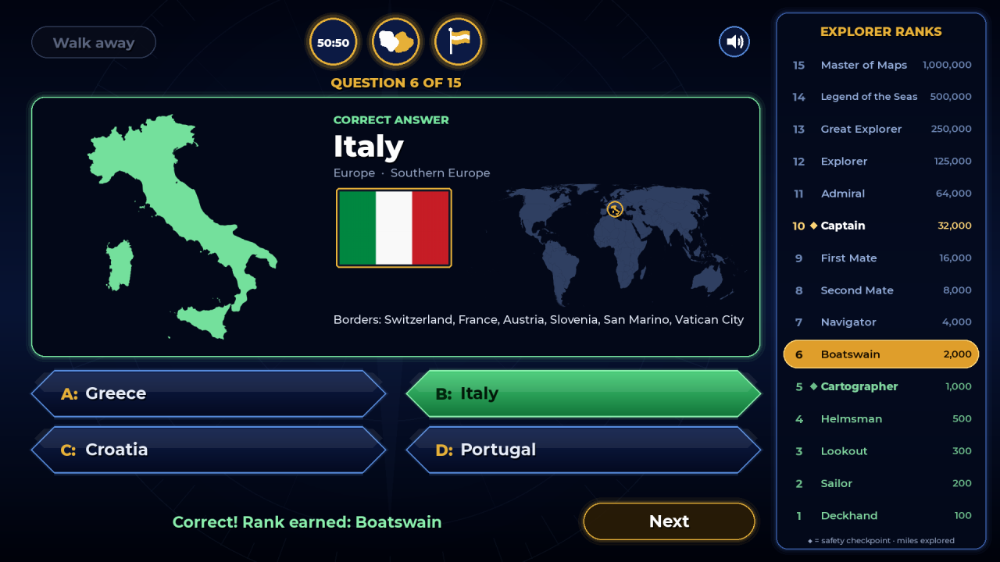

# WhoWantsToBeAnExplorer

[](https://github.com/Maurus1988kk/WhoWantsToBeAnExplorer/actions/workflows/ci.yml)

[English](README.md) · **Italiano**

Quiz di geografia per adulti, volutamente difficile: al centro dello schermo compare
**solo la sagoma di uno stato** (bianco pieno su nero, nord in alto, senza confini interni
né scritte) e bisogna riconoscerlo fra quattro risposte. Quindici domande di difficoltà
crescente, tre aiuti, gradi da esploratore al posto dei soldi.

Il gioco è interamente giocabile in **italiano e in inglese**: la lingua si cambia dalla
schermata iniziale o dalle Impostazioni.

Grafica, nomi, icone e suoni sono originali: il formato si ispira ai quiz televisivi a
domande crescenti, ma non contiene loghi, jingle o elementi grafici di programmi esistenti.

| Schermata iniziale | Domanda | Rivelazione |
|---|---|---|
|  |  |  |

---

## Come si gioca

- **15 domande.** Le prime tre usano le sagome più iconiche (fascia 1). Poi la difficoltà
  sale di una fascia ogni tre domande, fino alle quasi impossibili della fascia 5 (domande 13-15).
  Nella stessa partita uno stato non si ripete mai.
- **Una sola risposta giusta.** Clicca una risposta o premi **A, B, C, D**. Compare la
  domanda *«È la tua risposta definitiva?»* (si può disattivare nelle impostazioni):
  **Sì** (o Invio) blocca la risposta. Seguono qualche istante di suspense e poi la rivelazione.
- **Errore = fine partita.** Si scende all'ultima **soglia di sicurezza** raggiunta:
  domanda 5 (Cartografo, 1.000 miglia) o domanda 10 (Capitano, 32.000 miglia). Prima
  della domanda 5 si torna a zero.
- **Mi ritiro** (o Esc): termini tenendo il grado già conquistato.
- **Dopo ogni risposta** la sagoma si colora e compaiono nome, continente, bandiera, una
  piccola mappa del mondo con lo stato evidenziato e l'elenco dei confinanti. Così si
  impara qualcosa anche quando si sbaglia.

### Gradi (miglia esplorate)

| # | Grado | Miglia | | # | Grado | Miglia |
|---|---|---|---|---|---|---|
| 1 | Mozzo | 100 | | 9 | Primo Ufficiale | 16.000 |
| 2 | Marinaio | 200 | | 10 | **Capitano** ◆ soglia | 32.000 |
| 3 | Vedetta | 300 | | 11 | Ammiraglio | 64.000 |
| 4 | Timoniere | 500 | | 12 | Esploratore | 125.000 |
| 5 | **Cartografo** ◆ soglia | 1.000 | | 13 | Grande Esploratore | 250.000 |
| 6 | Nostromo | 2.000 | | 14 | Leggenda dei Mari | 500.000 |
| 7 | Navigatore | 4.000 | | 15 | Signore delle Mappe | 1.000.000 |
| 8 | Secondo Ufficiale | 8.000 | | | | |

### Aiuti

Ogni aiuto si usa una sola volta per partita. Più aiuti si possono usare anche sulla stessa domanda.

| Aiuto | Effetto |
|---|---|
| **50:50** | Elimina due risposte sbagliate scelte a caso. |
| **Stato confinante** | La sagoma viene sostituita da una vista con lo stato misterioso in bianco e un vicino in oro, con il nome del vicino. Il gioco sceglie, se possibile, un confinante che **non** sia tra le quattro risposte e che sia tra i più riconoscibili. Per le isole senza confini terrestri mostra il *paese più vicino*. |
| **Bandiera** | Mostra la bandiera dello stato misterioso sotto la sagoma. |

### Timer, tasti e impostazioni

- **Timer** (spento di default): 45 s per le domande 1-5, 60 s per le domande 6-10,
  nessun limite per le domande 11-15. Se scade, vale come risposta sbagliata.
- **Tasti**: A-D risposta · Invio, S o Y conferma · Esc o N annulla · Esc per ritirarsi · F11 schermo intero.
- La finestra è ridimensionabile e tutto si scala in proporzione.
- **Impostazioni**: lingua, timer, conferma «risposta definitiva», audio, stati in gioco/esclusi
  (con filtro per fascia). Deve sempre restare in gioco un numero minimo di stati per fascia.
- **Classifica**: le 10 migliori partite (nome, grado, miglia, data).

Impostazioni e classifica sono salvate in `%APPDATA%\WhoWantsToBeAnExplorer\`
(`impostazioni.json`, `classifica.json`; su macOS/Linux `~/.WhoWantsToBeAnExplorer/`). I file
vengono scritti in modo atomico, e un file danneggiato o modificato male viene ignorato invece
di far chiudere il gioco. Se il gioco va in errore mostra un messaggio e scrive il dettaglio in
`errore.log` nella stessa cartella. **Il gioco non si collega mai alla rete e non raccoglie dati.**

---

## Avvio

### Eseguibile per Windows

Scarica `WhoWantsToBeAnExplorer.exe` dalla pagina [Releases](../../releases) di questo
repository, oppure crealo con `build.bat`: lo script crea l'ambiente virtuale `.venv`, installa
le dipendenze con versioni fissate (`requirements-build.txt`: pygame-ce e PyInstaller),
**esegue i test** e produce `dist\WhoWantsToBeAnExplorer.exe`. È un exe unico con icona e
risorse incluse, da copiare dove si vuole.

> **Avviso SmartScreen.** L'exe non è firmato digitalmente, quindi al primo avvio Windows
> può mostrare «Windows ha protetto il PC». Clicca **Ulteriori informazioni** e poi
> **Esegui comunque**. Alcuni antivirus segnalano per prudenza gli exe creati con
> PyInstaller: in quel caso si può avviare il gioco da sorgente (vedi sotto).

### Da sorgente (Windows)

```bat
py -m venv .venv
.venv\Scripts\python -m pip install -r requirements.txt
.venv\Scripts\python main.py
```

### Da sorgente (macOS / Linux)

```sh
python3 -m venv .venv
.venv/bin/python -m pip install -r requirements.txt
.venv/bin/python main.py
```

A runtime servono solo **pygame-ce** e la libreria standard di Python (Python 3.11 o successivo).

---

## Sviluppo

### Test

```bat
python -m unittest discover -s tests -v
```

I test dei dati e della logica non richiedono pygame. I test dell'interfaccia
(`tests/test_interfaccia.py`) richiedono pygame-ce e girano senza aprire finestre (driver SDL
«dummy»); senza pygame-ce vengono saltati. Controllano:

- che ogni stato abbia sagoma, bandiera, fascia, almeno un vicino o un «paese più vicino»
  e almeno 3 distrattori validi per ogni fase;
- che ogni fascia abbia almeno 20 stati e che i nomi siano corretti, in entrambe le lingue;
- con 1000 partite simulate: che le fasce corrispondano sempre alle domande, che non ci siano
  opzioni duplicate né la risposta giusta due volte, che il 50:50 non elimini mai la risposta
  giusta, che l'aiuto confinante non mostri mai lo stato misterioso e che i gradi dopo errore,
  ritiro o vittoria siano corretti;
- che italiano e inglese abbiano gli stessi testi e gli stessi segnaposto;
- che impostazioni e classifica resistano ai file danneggiati;
- che ogni schermata si disegni correttamente nelle due lingue, giocando partite complete
  (vittoria, errore, ritiro, tempo scaduto) con mouse e tastiera simulati.

GitHub Actions esegue i test su Windows e Linux a ogni push e pull request
(`.github/workflows/ci.yml`).

### Pubblicare una nuova versione

1. Aggiorna `VERSIONE` in `config.py` e aggiungi una sezione a `CHANGELOG.md`.
2. Fai il commit, poi crea e invia il tag corrispondente, per esempio
   `git tag v1.1.0 && git push origin v1.1.0`.
3. GitHub Actions (`.github/workflows/release.yml`) controlla che il tag corrisponda alla
   versione, esegue i test, crea l'exe e lo pubblica come release su GitHub.

### Traduzioni

- Testi dell'interfaccia, gradi e crediti sono in `lingua.py` (un dizionario per lingua;
  i test controllano che le due lingue abbiano le stesse chiavi).
- I nomi degli stati sono in `assets/stati.json` (`nome` in italiano, `nome_en` in inglese).
  I nomi inglesi predefiniti sono anche in `NOMI_EN` in `tools/prepara_dati.py`, così
  sopravvivono alla rigenerazione dei dati.
- Continenti e regioni sono salvati in italiano in `stati.json` e tradotti con `LUOGHI_EN` in
  `lingua.py`.

---

## Dati: come sono stati preparati e come rigenerarli

Tutto ciò che sta in `assets/` è generato e già incluso. Per rigenerarlo:

```bat
py -m venv .venv-tools
.venv-tools\Scripts\python -m pip install -r tools\requirements-tools.txt
.venv-tools\Scripts\python tools\prepara_dati.py      (circa 4 minuti)
.venv-tools\Scripts\python tools\genera_suoni.py      (pochi secondi, solo libreria standard)
```

`prepara_dati.py` scarica le sorgenti in `tools/_cache/` (opzione `--cache` per cambiare
cartella) e usa shapely, Pillow e numpy, che **non** finiscono nell'exe. Le modifiche
manuali a `assets/stati.json` (nomi nelle due lingue, fasce, esclusioni, continente, regione)
vengono **conservate** a ogni rigenerazione. Con `--ripristina` si torna ai valori predefiniti
scritti nello script.

### Sorgenti

- **Sagome**: Natural Earth *Admin 0 – Countries*, scala 1:10m (repository
  `nvkelso/natural-earth-vector`, cartella `geojson`), pubblico dominio. Si usa la variante
  **«punto di vista italiano»** (`ne_10m_admin_0_countries_ita`), cioè i confini secondo
  le posizioni ufficiali italiane: la Crimea è dell'Ucraina, il Marocco è senza Sahara
  Occidentale, Cipro e la Somalia sono unificate.
- **Bandiere**: `hampusborgos/country-flags`, PNG da 250 px, pubblico dominio (licenza
  dichiarata «PD»). Nel 2025 le PNG sono state tolte dal ramo principale, quindi lo script
  usa l'ultimo commit che le contiene (`ba2cf41`), fissato per hash. Lo script verifica
  che ci sia una bandiera per ognuno dei 197 stati, compresi Kosovo (`XK`), Palestina,
  Taiwan e Vaticano. L'associazione avviene tramite il codice ISO.
- **Font**: Montserrat (`JulietaUla/Montserrat`), SIL Open Font License 1.1.

### Elenco degli stati

Ci sono i 193 membri ONU più Vaticano, Kosovo, Palestina e Taiwan, cioè **197 stati**. Sono
esclusi il Sahara Occidentale e i territori dipendenti (Groenlandia, Porto Rico, ecc.).
Alcune unità separate di Natural Earth vengono fuse nello stato a cui appartengono, per
evitare buchi o tacche inesistenti nelle sagome:

- Somaliland → Somalia;
- Cipro Nord, zona cuscinetto ONU, Akrotiri e Dhekelia → Cipro;
- Hong Kong e Macao → Cina;
- Åland → Finlandia;
- Guantánamo → Cuba;
- Baikonur → Kazakistan;
- Siachen → India.

Alcune piccole aree restano senza stato nella vista italiana. Lo script le attribuisce:

- all'amministratore de facto (Ilemi → Kenya, Abyei → Sudan, Rincón de Artigas → Brasile);
- tranne le Alture del Golan, che vanno alla Siria;
- e il Campo di ghiaccio Patagonico Sud, assegnato sia al Cile sia all'Argentina perché il confine non è definito.

**Esclusi di default** (la sagoma sarebbe una nuvola di puntini): Kiribati, Tuvalu, Isole
Marshall, Maldive, Nauru, Palau, Micronesia, Seychelles. Restano comunque generati e si
possono riattivare (`"escluso": false` in `stati.json`, oppure dalle Impostazioni del gioco).

**Nomi italiani**: si parte dal campo `NAME_IT` di Natural Earth e lo script lo corregge
dove serve. Le correzioni sono elencate in `anteprime/nomi_corretti.txt`, per esempio:
Birmania → Myanmar, eSwatini → Eswatini, Stati Uniti d'America → Stati Uniti,
Principato di Monaco → Monaco. **Nomi inglesi**: si usa la forma breve comune
(per esempio United States, Czech Republic, Ivory Coast, East Timor).

### Quali parti di uno stato entrano nella sagoma

Ogni stato mostra la sua parte principale e le isole «naturalmente sue». Mancano invece i
territori d'oltremare lontani. La regola è automatica:

1. Si parte dalla parte più grande (o dalle parti forzate dalle eccezioni).
2. Una parte di area *a* viene tenuta se dista da una parte già tenuta al massimo
   `max(200 km, 0,4·√A_principale + 1,2·√a)`. La crescita segue le catene di isole
   (per esempio le Aleutine) ed è più generosa con le parti grandi (Alaska, Malaysia
   peninsulare, Sardegna).
3. I «puntini» minuscoli e staccati vengono tolti, perché allargherebbero soltanto il riquadro.

A questa regola si aggiungono le **eccezioni manuali** in `assets/eccezioni_sagome.json`.
Ogni eccezione usa riquadri `rimuovi` / `mantieni` in gradi, e nello stesso file ci sono i
parametri della regola:

| Stato | Scelta |
|---|---|
| Giappone | tolte Okinawa/Ryukyu: restano Hokkaido–Kyushu e le isole vicine |
| Spagna | tolte Ceuta, Melilla e le plazas de soberanía (le Canarie sono già escluse dalla regola) |
| Norvegia | tolte Svalbard, Jan Mayen, Bjørnøya, Bouvet |
| India | tenute Andamane e Nicobare |
| Guinea Equatoriale | tenuta Bioko (con la capitale) |
| São Tomé e Príncipe | tenuta Príncipe |
| Australia | tolta Lord Howe |
| Ecuador | tolte le Galápagos |
| Taiwan | tolte Kinmen e Matsu (a ridosso della costa cinese) |

La regola toglie da sola, per esempio: Guyana francese e Riunione dalla Francia; Hawaii dagli
Stati Uniti (l'Alaska resta); Canarie dalla Spagna; Azzorre e Madeira dal Portogallo; Isola di
Pasqua dal Cile; isole sub-antartiche e Chatham dalla Nuova Zelanda.

L'elenco completo delle parti scartate è in `anteprime/parti_scartate.txt`.

### Proiezione e rendering

- **Antimeridiano**: prima di proiettare, le longitudini vengono riportate attorno alla
  parte principale. Così Russia, Figi e Stati Uniti con le Aleutine restano in un pezzo solo.
- **Proiezione locale**: per ogni stato si usa un'azimutale equivalente di Lambert centrata
  sul centroide delle parti tenute (formula implementata nello script). In questo modo le
  forme non vengono distorte.
- **Sagome**: PNG bianco su trasparente, **1024 px sul lato lungo**, disegnate a 4× e poi
  ridotte (antialiasing). Tutte riempiono lo stesso riquadro, quindi la dimensione reale
  non è un indizio: il Vaticano è grande quanto la Russia. Gli stati enclave restano buchi
  nella sagoma, per esempio il Lesotho dentro il Sudafrica.

### Aiuto «stato confinante»

- I **confinanti terrestri** si calcolano sulle parti mostrate, con una tolleranza di 1 km.
  Per questo la Francia non risulta confinante del Brasile.
- Per gli stati senza confini di terra si prendono gli **stati più vicini**, e la
  didascalia dice «Paese più vicino».
- Per ogni stato viene salvata una lista ordinata di **fino a 3 candidati**: prima i
  confinanti più riconoscibili (fascia più bassa, poi confine più lungo), e se non bastano
  gli stati vicini. La scelta finale avviene durante il gioco, in base alle quattro risposte uscite.
- Ogni coppia (stato, candidato) ha un'immagine pronta in `assets/vicini/`. È disegnata
  nella stessa proiezione locale, con il misterioso in bianco e il vicino in oro.
- La vista è centrata sullo stato misterioso. Un vicino enorme viene ritagliato a circa
  2,5 volte l'estensione dello stato. Un vicino lontano allarga la vista quanto basta per farlo vedere.
- Il punto in cui scrivere il nome è il «polo di inaccessibilità» della parte visibile del
  vicino, salvato in coordinate normalizzate. Il nome lo disegna il gioco.

### Difficoltà, similarità e risposte sbagliate

- **Fasce** da 1 (iconica) a 5 (quasi impossibile), assegnate a mano nello script e
  modificabili nel campo `"fascia"` di `assets/stati.json`. Ogni fascia ha almeno 20 stati
  giocabili: 28 / 38 / 46 / 43 / 34.
- **Similarità delle sagome**: ogni sagoma viene centrata sul centroide, scalata per area
  e rasterizzata a 64×64. Per ogni coppia di stati si calcola l'IoU (intersezione su unione)
  e si tiene il migliore fra tre scale (0,85 / 1 / 1,15). Per ogni stato si salvano i 15 più simili.
- **Distrattori**:
  - domande 1-5: stati di altri continenti, a caso;
  - domande 6-10: stessa regione, poi stesso continente;
  - domande 11-15: le sagome più simili, preferibilmente dello stesso continente.

  Le quattro opzioni sono sempre mescolate.

### Verifica visiva

Lo script genera in `anteprime/` (cartella non inclusa nell'exe):

- la griglia di tutte le sagome con nome, codice e fascia (`sagome_01..05.png`);
- un campione di compositi «confinante» con il punto dell'etichetta (`compositi_esempio.png`).

### Modificare fasce ed esclusioni

- **Fascia di uno stato**: cambia `"fascia"` in `assets/stati.json` (e, per i nuovi
  valori predefiniti, la tabella `STATI` in `tools/prepara_dati.py`). L'effetto è immediato
  avviando da sorgente; per l'exe va rilanciato `build.bat`.
- **Esclusioni predefinite**: cambia `"escluso"` in `assets/stati.json`. Le esclusioni
  scelte dal giocatore nelle Impostazioni stanno invece in `%APPDATA%` e hanno la precedenza.
  Il pulsante «Ripristina esclusioni predefinite» le riporta ai valori del file.
- **Sagome**: aggiungi o modifica un riquadro in `assets/eccezioni_sagome.json` e rilancia
  `tools/prepara_dati.py`.

---

## Struttura del progetto

```
main.py            avvio, finestra, scalatura, F11, ciclo a 60 FPS, gestione degli errori
config.py          costanti, gradi, colori, resource_path(), impostazioni e classifica
lingua.py          testi in italiano e inglese, titoli dei gradi, formato dei numeri
dati.py            lettura di stati.json, immagini con cache, mappa del mondo
partita.py         logica di gioco (domande, distrattori, gradi) senza pygame
aiuti.py           50:50, confinante, bandiera + icone disegnate in pygame
interfaccia.py     grafica e schermate (titolo, gioco, fine, classifica, impostazioni, crediti)
audio.py           suoni ed eventuale assenza di scheda audio
assets/            dati generati, bandiere, font, suoni, icona
tools/             prepara_dati.py, genera_suoni.py
tests/             dati, traduzioni, salvataggi, 1000 partite simulate, interfaccia senza finestra
anteprime/         griglie di controllo (non incluse nell'exe)
docs/screenshots/  immagini di questo README
build.bat          crea .venv, esegue i test, produce dist\WhoWantsToBeAnExplorer.exe
.github/workflows/ CI (test) e release (exe per Windows)
```

## Crediti e licenze

- Dati geografici: **Natural Earth** — pubblico dominio.
- Bandiere: **hampusborgos/country-flags** — pubblico dominio («PD»), origine Wikimedia Commons.
- Carattere: **Montserrat** © The Montserrat Project Authors — SIL Open Font License 1.1 (`assets/font/OFL.txt`).
- Suoni: originali, sintetizzati da `tools/genera_suoni.py`.
- Libreria: **pygame-ce** — LGPL 2.1.

Dettagli in `assets/LICENZE.txt`.

## Licenza

Il codice del gioco è distribuito con [licenza MIT](LICENSE). Le risorse incluse mantengono
le proprie licenze (dati e bandiere di pubblico dominio, Montserrat con SIL Open Font License),
elencate qui sopra e in `assets/LICENZE.txt`.
