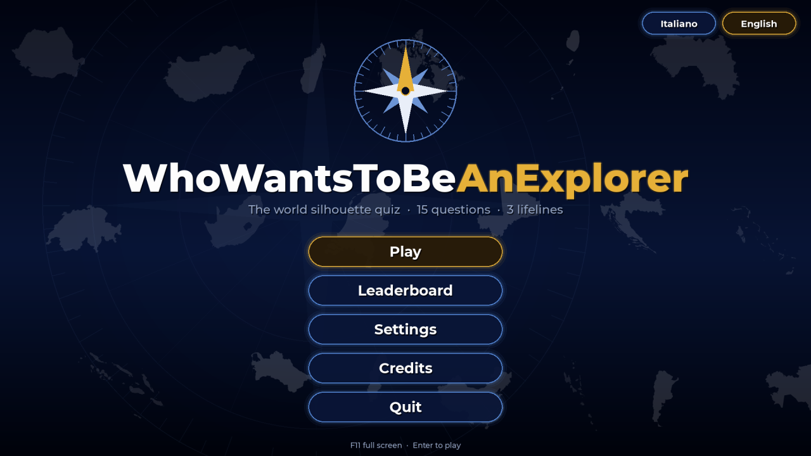
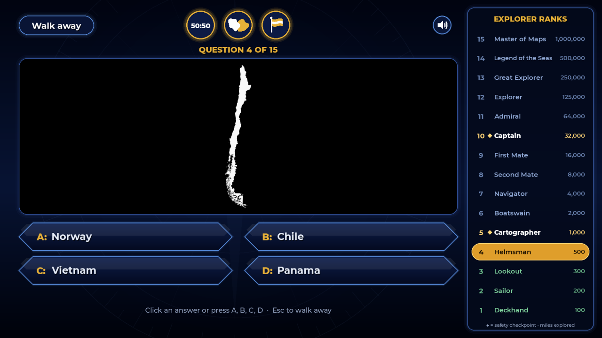
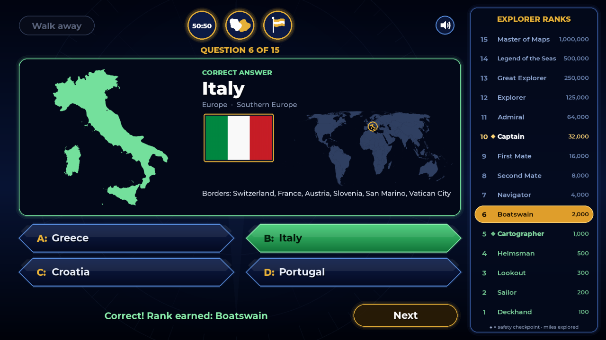

# WhoWantsToBeAnExplorer

[](https://github.com/Maurus1988kk/WhoWantsToBeAnExplorer/actions/workflows/ci.yml)

**English** · [Italiano](README.it.md)

A deliberately hard geography quiz for adults. The screen shows **only the silhouette of a
country** (solid white on black, north up, no internal borders or labels) and you have to pick
it out of four answers. Fifteen questions of increasing difficulty, three lifelines, explorer
ranks instead of money.

The game is fully playable in **English and Italian**: switch language from the title screen
or from Settings.

Graphics, names, icons and sounds are original. The format is inspired by TV quiz shows with
escalating questions, but the game contains no logos, jingles or graphics from existing programs.

| Title screen | Question | Reveal |
|---|---|---|
|  |  |  |

---

## How to play

- **15 questions.** The first three use the most iconic silhouettes (tier 1). Difficulty then
  rises one tier every three questions, up to the near-impossible tier 5 (questions 13-15).
  A country never repeats within the same game.
- **One right answer.** Click an answer or press **A, B, C, D**. The game asks
  *"Is that your final answer?"* (this can be turned off in Settings): **Yes** (or Enter) locks
  it in. A few seconds of suspense, then the reveal.
- **A mistake ends the game.** You drop back to the last **safety checkpoint** you reached:
  question 5 (Cartographer, 1,000 miles) or question 10 (Captain, 32,000 miles). Before
  question 5 you go back to zero.
- **Walk away** (or Esc): you stop and keep the rank you have already earned.
- **After every answer** the silhouette is colored in and you see the name, continent, flag,
  a small world map with the country highlighted and the list of its neighbors. You learn
  something even when you get it wrong.

### Ranks (miles explored)

| # | Rank | Miles | | # | Rank | Miles |
|---|---|---|---|---|---|---|
| 1 | Deckhand | 100 | | 9 | First Mate | 16,000 |
| 2 | Sailor | 200 | | 10 | **Captain** ◆ checkpoint | 32,000 |
| 3 | Lookout | 300 | | 11 | Admiral | 64,000 |
| 4 | Helmsman | 500 | | 12 | Explorer | 125,000 |
| 5 | **Cartographer** ◆ checkpoint | 1,000 | | 13 | Great Explorer | 250,000 |
| 6 | Boatswain | 2,000 | | 14 | Legend of the Seas | 500,000 |
| 7 | Navigator | 4,000 | | 15 | Master of Maps | 1,000,000 |
| 8 | Second Mate | 8,000 | | | | |

### Lifelines

Each lifeline can be used once per game. You can use several on the same question.

| Lifeline | Effect |
|---|---|
| **50:50** | Removes two wrong answers at random. |
| **Neighbor** | Replaces the silhouette with a view of the mystery country in white and one neighbor in gold, labeled with the neighbor's name. When possible the game picks a neighbor that is **not** among the four answers and is among the most recognizable. For islands with no land borders it shows the *nearest country*. |
| **Flag** | Shows the flag of the mystery country under the silhouette. |

### Timer, keys and settings

- **Timer** (off by default): 45 s for questions 1-5, 60 s for questions 6-10, no limit for
  questions 11-15. If time runs out, it counts as a wrong answer.
- **Keys**: A-D answer · Enter, Y or S confirms · Esc or N cancels · Esc walks away · F11 full screen.
- The window can be resized and everything scales proportionally.
- **Settings**: language, timer, "final answer" confirmation, sound, and which countries are in
  play (with a filter by tier). A minimum number of countries must stay in play for each tier.
- **Leaderboard**: the 10 best games (name, rank, miles, date).

Settings and leaderboard are saved in `%APPDATA%\WhoWantsToBeAnExplorer\`
(`impostazioni.json` = settings, `classifica.json` = leaderboard; on macOS/Linux
`~/.WhoWantsToBeAnExplorer/`). Files are written atomically, and a damaged or hand-edited file
is ignored rather than crashing the game. If the game hits an unexpected error it shows a
message and writes the details to `errore.log` in the same folder.
**The game never connects to the network and collects no data.**

---

## Running the game

### Windows executable

Download `WhoWantsToBeAnExplorer.exe` from the
[Releases](../../releases) page of this repository, or build it yourself with `build.bat`. The
script creates the `.venv` virtual environment, installs the pinned dependencies
(`requirements-build.txt`: pygame-ce and PyInstaller), **runs the tests** and produces
`dist\WhoWantsToBeAnExplorer.exe`. It is a single exe with the icon and all resources included,
and you can copy it anywhere.

> **SmartScreen warning.** The exe is not digitally signed, so on first launch Windows may say
> "Windows protected your PC". Click **More info** and then **Run anyway**. Some antivirus
> programs flag PyInstaller executables out of caution: in that case run the game from source
> (see below).

### From source (Windows)

```bat
py -m venv .venv
.venv\Scripts\python -m pip install -r requirements.txt
.venv\Scripts\python main.py
```

### From source (macOS / Linux)

```sh
python3 -m venv .venv
.venv/bin/python -m pip install -r requirements.txt
.venv/bin/python main.py
```

At runtime the game only needs **pygame-ce** and the Python standard library (Python 3.11 or
newer).

---

## Development

### Tests

```bat
python -m unittest discover -s tests -v
```

The data and game-logic tests do not need pygame. The interface tests (`tests/test_interfaccia.py`)
need pygame-ce and run without opening a window (SDL "dummy" driver); without pygame-ce they are
skipped. They check:

- that every country has a silhouette, flag, tier, at least one neighbor or "nearest country"
  and at least 3 valid distractors for each phase;
- that every tier has at least 20 countries and that names are correct, in both languages;
- with 1000 simulated games: that tiers always match the questions, that there are no
  duplicate options or two right answers, that 50:50 never removes the right answer, that the
  neighbor lifeline never shows the mystery country, and that ranks after a mistake, walking
  away or winning are correct;
- that Italian and English have the same texts and placeholders;
- that settings and leaderboard survive damaged files;
- that every screen draws correctly in both languages, playing complete games (win, mistake,
  walking away, time running out) with simulated mouse and keyboard.

GitHub Actions runs the tests on Windows and Linux at every push and pull request
(`.github/workflows/ci.yml`).

### Publishing a new version

1. Update `VERSIONE` in `config.py` and add a section to `CHANGELOG.md`.
2. Commit, then create and push a matching tag, e.g. `git tag v1.1.0 && git push origin v1.1.0`.
3. GitHub Actions (`.github/workflows/release.yml`) checks that the tag matches the version,
   runs the tests, builds the exe and publishes it as a GitHub release.

### Translations

- Interface texts, rank titles and credits are in `lingua.py` (one dictionary per language;
  the tests check that both languages have the same keys).
- Country names are in `assets/stati.json` (`nome` in Italian, `nome_en` in English).
  The English defaults also live in `NOMI_EN` in `tools/prepara_dati.py`, so they survive a
  data regeneration.
- Continents and regions are stored in Italian in `stati.json` and translated through
  `LUOGHI_EN` in `lingua.py`.

The source code (identifiers and comments) is written in Italian.

---

## Data: how it was prepared and how to regenerate it

Everything in `assets/` is generated and already included. To regenerate it:

```bat
py -m venv .venv-tools
.venv-tools\Scripts\python -m pip install -r tools\requirements-tools.txt
.venv-tools\Scripts\python tools\prepara_dati.py      (about 4 minutes)
.venv-tools\Scripts\python tools\genera_suoni.py      (a few seconds, standard library only)
```

`prepara_dati.py` downloads the sources into `tools/_cache/` (use `--cache` to change folder) and
uses shapely, Pillow and numpy, which do **not** end up in the exe. Manual edits to
`assets/stati.json` (names in both languages, tiers, exclusions, continent, region) are
**kept** at every regeneration. `--ripristina` goes back to the defaults written in the script.

### Sources

- **Silhouettes**: Natural Earth *Admin 0 – Countries*, 1:10m scale (repository
  `nvkelso/natural-earth-vector`, `geojson` folder), public domain. The game uses the
  **"Italian point of view"** variant (`ne_10m_admin_0_countries_ita`), i.e. borders according
  to official Italian positions: Crimea belongs to Ukraine, Morocco is shown without Western
  Sahara, Cyprus and Somalia are unified.
- **Flags**: `hampusborgos/country-flags`, 250 px PNGs, public domain (declared license "PD").
  In 2025 the PNGs were removed from the main branch, so the script uses the last commit that
  contains them (`ba2cf41`), pinned by hash. The script checks that there is a flag for each of
  the 197 countries, including Kosovo (`XK`), Palestine, Taiwan and Vatican City. Flags are
  matched by ISO code.
- **Typeface**: Montserrat (`JulietaUla/Montserrat`), SIL Open Font License 1.1.

### List of countries

The 193 UN members plus Vatican City, Kosovo, Palestine and Taiwan: **197 countries**. Western
Sahara and dependent territories (Greenland, Puerto Rico, etc.) are excluded. Some separate
Natural Earth units are merged into the country they belong to, to avoid holes or notches that
don't exist in the silhouettes:

- Somaliland → Somalia;
- Northern Cyprus, the UN buffer zone, Akrotiri and Dhekelia → Cyprus;
- Hong Kong and Macao → China;
- Åland → Finland;
- Guantánamo → Cuba;
- Baikonur → Kazakhstan;
- Siachen → India.

A few small areas have no country in the Italian view. The script assigns them:

- to the de facto administrator (Ilemi → Kenya, Abyei → Sudan, Rincón de Artigas → Brazil);
- except the Golan Heights, which go to Syria;
- and the Southern Patagonian Ice Field, assigned to both Chile and Argentina because the border
  is not defined.

**Excluded by default** (the silhouette would be a cloud of dots): Kiribati, Tuvalu, Marshall
Islands, Maldives, Nauru, Palau, Micronesia, Seychelles. They are still generated and can be
re-enabled (`"escluso": false` in `stati.json`, or from the in-game Settings).

**Italian names**: the script starts from Natural Earth's `NAME_IT` field and corrects it where
needed. Corrections are listed in `anteprime/nomi_corretti.txt`, for example:
Birmania → Myanmar, eSwatini → Eswatini, Stati Uniti d'America → Stati Uniti,
Principato di Monaco → Monaco. **English names** use the common short form
(e.g. United States, Czech Republic, Ivory Coast, East Timor).

### Which parts of a country go into the silhouette

Each country shows its main part and the islands that "naturally" belong to it. Distant overseas
territories are left out. The rule is automatic:

1. Start from the largest part (or from the parts forced by the exceptions).
2. A part of area *a* is kept if it lies within
   `max(200 km, 0.4·√A_main + 1.2·√a)` of a part already kept. Growth follows island chains
   (e.g. the Aleutians) and is more generous with large parts (Alaska, Peninsular Malaysia,
   Sardinia).
3. Tiny detached "dots" are removed, because they would only enlarge the bounding box.

On top of this rule there are **manual exceptions** in `assets/eccezioni_sagome.json`. Each
exception uses `rimuovi` (remove) / `mantieni` (keep) boxes in degrees, and the same file holds
the parameters of the rule:

| Country | Choice |
|---|---|
| Japan | Okinawa/Ryukyu removed: Hokkaido–Kyushu and nearby islands remain |
| Spain | Ceuta, Melilla and the plazas de soberanía removed (the Canaries are already excluded by the rule) |
| Norway | Svalbard, Jan Mayen, Bjørnøya, Bouvet removed |
| India | Andaman and Nicobar Islands kept |
| Equatorial Guinea | Bioko kept (with the capital) |
| São Tomé and Príncipe | Príncipe kept |
| Australia | Lord Howe removed |
| Ecuador | Galápagos removed |
| Taiwan | Kinmen and Matsu removed (right off the Chinese coast) |

The rule alone removes, for example: French Guiana and Réunion from France; Hawaii from the
United States (Alaska stays); the Canaries from Spain; the Azores and Madeira from Portugal;
Easter Island from Chile; the sub-Antarctic islands and the Chathams from New Zealand.

The full list of discarded parts is in `anteprime/parti_scartate.txt`.

### Projection and rendering

- **Antimeridian**: before projecting, longitudes are shifted around the main part, so Russia,
  Fiji and the United States with the Aleutians stay in one piece.
- **Local projection**: each country uses a Lambert azimuthal equal-area projection centered on
  the centroid of the parts kept (formula implemented in the script), so shapes are not distorted.
- **Silhouettes**: white on transparent PNGs, **1024 px on the long side**, drawn at 4× and
  then downscaled (antialiasing). They all fill the same box, so real size is not a clue:
  Vatican City is as big as Russia. Enclaves remain holes in the silhouette, e.g. Lesotho
  inside South Africa.

### "Neighbor" lifeline

- **Land neighbors** are computed on the parts shown, with a 1 km tolerance. That is why France
  does not border Brazil.
- For countries without land borders the **nearest countries** are used, and the caption says
  "Nearest country".
- For each country an ordered list of **up to 3 candidates** is saved: first the most
  recognizable land neighbors (lowest tier, then longest border), then nearby countries if
  needed. The final choice happens in game, based on the four answers shown.
- Each (country, candidate) pair has a ready-made image in `assets/vicini/`, drawn in the same
  local projection with the mystery country in white and the neighbor in gold.
- The view is centered on the mystery country. A huge neighbor is cropped to about 2.5 times
  the country's extent; a distant neighbor widens the view just enough to show it.
- The point where the name is written is the "pole of inaccessibility" of the visible part of
  the neighbor, saved in normalized coordinates. The game draws the name.

### Difficulty, similarity and wrong answers

- **Tiers** from 1 (iconic) to 5 (near impossible), assigned by hand in the script and editable
  in the `"fascia"` field of `assets/stati.json`. Each tier has at least 20 playable countries:
  28 / 38 / 46 / 43 / 34.
- **Silhouette similarity**: each silhouette is centered on its centroid, scaled by area and
  rasterized at 64×64. For each pair of countries the IoU (intersection over union) is computed,
  keeping the best of three scales (0.85 / 1 / 1.15). The 15 most similar are saved per country.
- **Distractors**:
  - questions 1-5: countries from other continents, at random;
  - questions 6-10: same region, then same continent;
  - questions 11-15: the most similar silhouettes, preferably from the same continent.

  The four options are always shuffled.

### Visual check

The script generates in `anteprime/` (not included in the exe):

- the grid of all silhouettes with name, code and tier (`sagome_01..05.png`);
- a sample of "neighbor" composites with the label point (`compositi_esempio.png`).

### Changing tiers and exclusions

- **A country's tier**: change `"fascia"` in `assets/stati.json` (and, for the new defaults,
  the `STATI` table in `tools/prepara_dati.py`). Running from source picks it up immediately;
  for the exe, run `build.bat` again.
- **Default exclusions**: change `"escluso"` in `assets/stati.json`. Exclusions chosen by the
  player in Settings are stored in `%APPDATA%` and take precedence. The "Restore default
  exclusions" button resets them to the values in the file.
- **Silhouettes**: add or change a box in `assets/eccezioni_sagome.json` and run
  `tools/prepara_dati.py` again.

---

## Project structure

```
main.py            startup, window, scaling, F11, 60 FPS loop, crash handling
config.py          constants, ranks, colors, resource_path(), settings and leaderboard
lingua.py          Italian and English texts, rank titles, number format
dati.py            reads stati.json, cached images, world map
partita.py         game logic (questions, distractors, ranks) without pygame
aiuti.py           50:50, neighbor, flag + icons drawn with pygame
interfaccia.py     graphics and screens (title, game, end, leaderboard, settings, credits)
audio.py           sounds, and graceful handling of a missing sound card
assets/            generated data, flags, font, sounds, icon
tools/             prepara_dati.py, genera_suoni.py
tests/             data, translations, saves, 1000 simulated games, headless UI
anteprime/         check grids (not included in the exe)
docs/screenshots/  images for this README
build.bat          creates .venv, runs the tests, builds dist\WhoWantsToBeAnExplorer.exe
.github/workflows/ CI (tests) and release (Windows exe)
```

## Credits and licenses

- Geographic data: **Natural Earth**, public domain.
- Flags: **hampusborgos/country-flags**, public domain ("PD"), originally from Wikimedia Commons.
- Typeface: **Montserrat** © The Montserrat Project Authors, SIL Open Font License 1.1
  (`assets/font/OFL.txt`).
- Sounds: original, synthesized by `tools/genera_suoni.py`.
- Library: **pygame-ce**, LGPL 2.1.

Details are in `assets/LICENZE.txt`.

## License

The game's code is released under the [MIT License](LICENSE). The bundled resources keep
their own licenses (public domain data and flags, Montserrat under the SIL Open Font License),
listed above and in `assets/LICENZE.txt`.
